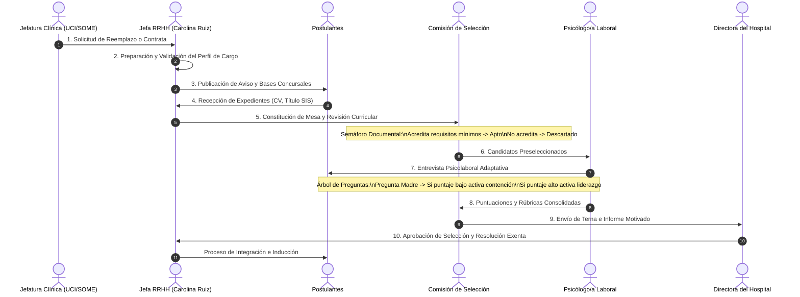
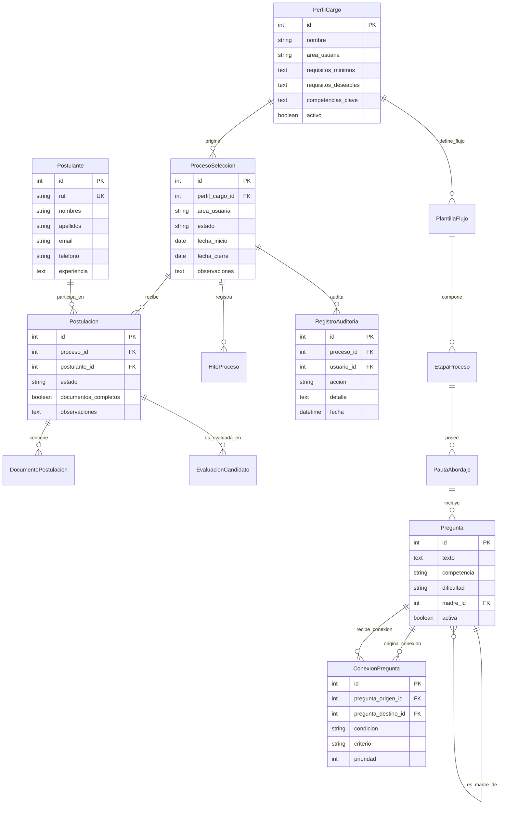

# Arquitectura del Sistema y Flujo de Negocio
## Proyecto: Hospital_Penco_IA
**Subdirección de Gestión y Desarrollo de las Personas — Hospital Penco Lirquén**  
*Servicio de Salud Talcahuano &bull; Octubre 2026*

---

## 1. Resumen Ejecutivo y Contexto Institucional

El **Hospital Penco Lirquén** es un establecimiento asistencial de mediana complejidad perteneciente a la red del **Servicio de Salud Talcahuano**, que atiende a una población beneficiaria superior a los 60.000 habitantes en las comunas de Penco y Tomé.

### La Problemática
En la actualidad, los procesos de reclutamiento abreviado (reemplazos prolongados y cargos a contrata bajo la **Ley 18.834**) gestionados por el Área de Desarrollo de las Personas —liderada por **Carolina Ruiz Parra**— presentan los siguientes dolores críticos:
1. **Dispersión documental:** Antecedentes curriculares y certificados dispersos en casillas de correo electrónico y carpetas físicas compartidas.
2. **Subjetividad en entrevistas:** Preguntas psicolaborales no estandarizadas que varían según el entrevistador, dificultando la comparabilidad de candidatos.
3. **Falta de trazabilidad auditable:** Dificultad para demostrar ante comisiones revisoras o Contraloría General de la República los fundamentos de la selección de un candidato por sobre otro.
4. **Tiempos de respuesta lentos:** Tiempos muertos entre la solicitud clínica de un reemplazo y la contratación efectiva del profesional.

### La Solución: Hospital_Penco_IA
Una plataforma web moderna, resiliente y segura concebida para:
- Estandarizar el ciclo de selección en **10 etapas normadas**.
- Proveer una **mesa digital de revisión curricular** con semáforo documental.
- Ofrecer un **motor adaptativo de preguntas por competencias** (árbol madre/hijas).
- Registrar una **pista de auditoría inmutable** de cada acuerdo de la comisión.
- Preparar la integración con un **módulo de Inteligencia Artificial (RAG)** para asistir a la psicóloga laboral en el diseño de preguntas de incidentes críticos.

### 👥 Definición de Usuarios del Sistema: ¿Quiénes son?
> **Claridad de Dominio:** Este sistema **NO es un software clínico ni atiende pacientes enfermos** (no gestiona fichas médicas, Rayen ni citas). Su dominio es exclusivamente la **Gestión de Personas y Contratación Pública (Ley 18.834 / Estatuto Administrativo)** en el Hospital Penco Lirquén.
> 
> **Todos los usuarios son PROFESIONALES**, agrupados en dos estamentos:
> 1. **Usuarios Institucionales (Equipo Evaluador y Directivo del Hospital):**
>    - **Jefatura de RR.HH. / Desarrollo de las Personas (Carolina Ruiz Parra):** Apertura de procesos, definición de bases, supervisión de etapas y formalización de contratos.
>    - **Psicólogo/a Laboral:** Creación de pautas de entrevista, banco de preguntas por incidentes críticos y rúbricas adaptativas.
>    - **Comisión de Selección y Jefaturas Médicas (UCI, SOME, Urgencias):** Revisión colegiada de expedientes (semáforo documental) y entrevistas técnicas.
>    - **Directora del Hospital:** Recepción de la terna final colegiada y firma de la Resolución Exenta de nombramiento.
>    - **Administrador Global TI:** Soporte, gestión de cuentas y control de la pista de auditoría inmutable.
> 2. **Postulantes (Personal de la Salud):**
>    - Profesionales y técnicos (médicos, enfermeros, TENS, administrativos) que postulan a concursos públicos abreviados o reemplazos prolongados.

### 🔐 Portal de Inicio de Sesión Institucional (Token-Based Security)
El sistema cuenta en su frontend con un **Portal de Inicio de Sesión Institucional** (Servicio de Salud Talcahuano &bull; Hospital Penco Lirquén) protegido por **Tokens de Seguridad Criptográficos** emitidos por Django REST Framework (`rest_framework.authtoken`):
- **Autenticación con Token:** Al iniciar sesión (`POST /api/auth/login/`), el backend verifica credenciales con Django Auth y emite un `token` único. Todas las peticiones fetch subsecuentes inyectan el encabezado seguro `Authorization: Token <key>`.
- **Selector Rápido de Perfiles de Prueba:** Cuadrícula 2x2 para seleccionar de inmediato los roles habilitados (*Carolina Ruiz, Psicólogo/a Laboral, Comisión Evaluadora, Administrador TI*).

### 🔄 Arquitectura de Mantenedores Intuitivos en Cascada (ERP)
Siguiendo los principios de software de gestión empresarial (ERP), los mantenedores operan en **cascada relacional**:
1. **Catálogo Maestro de Perfiles de Cargo (Origen de Cascada):** Define los requisitos mínimos de la Ley 18.834, competencias clave y área asistencial.
2. **Mantenedor de Concursos (Cascada Perfil → Proceso):** Al seleccionar un perfil de cargo, el sistema autocompleta en cascada los descriptores, área clínica y pauta reglamentaria de 10 etapas.
3. **Mesa de Postulantes (Cascada Concurso → Candidatos):** Filtrado dependiente del concurso activo para aislar nóminas, semáforo documental SIS y acuerdos colegiados.
4. **Banco de Preguntas Adaptativas (Cascada Madre → Hijas):** Ramificación en árbol condicional en cascada según calificación observada (< 3.0 activa contención; ≥ 4.0 activa liderazgo).
5. **Pista de Auditoría Transversal:** Cada mutación efectuada por el usuario autenticado viaja firmada con su token y se estampa en la bitácora legal.

---

## 2. Diagrama de Arquitectura de Software

La solución sigue una arquitectura desacoplada basada en microservicios ligeros / API RESTful, diseñada para correr eficientemente en servidores institucionales con sistema operativo **Debian Linux**.

```mermaid
graph TB
    subgraph Cliente["Capa de Presentación (Frontend)"]
        UI["React 18 + Vite (SPA)"]
        State["Mesa Digital de Selección"]
        Sim["Simulador de Preguntas Adaptativas"]
        UI --> State
        UI --> Sim
    end

    subgraph Gateway["Servidor Web y Proxy Inverso"]
        Nginx["Nginx (Debian Linux)\nPuerto 80 / 443 SSL"]
        Static["Archivos Estáticos\n(React Build + Media Uploads)"]
    end

    subgraph Backend["Capa de Negocio y API (Backend Django)"]
        Gunicorn["WSGI Server: Gunicorn\n(Gestor de procesos systemd)"]
        DRF["Django REST Framework 5.0"]
        
        subgraph Apps["Aplicaciones Modulares"]
            AppSel["apps.seleccion\n(Perfiles, Procesos, Postulantes, Auditoría)"]
            AppPau["apps.pautas\n(Plantillas de Flujo, Etapas, Rúbricas)"]
            AppPreg["apps.preguntas\n(Banco de Preguntas y Grafo Adaptativo)"]
        end
        
        Admin["Panel Administrativo Django\n(/admin/)"]
    end

    subgraph Persistencia["Capa de Datos"]
        DB[(PostgreSQL / SQLite3)\nIntegridad Referencial Estricta]
    end

    subgraph ModuloIA["Módulo de IA (Proyección Técnica - Lab 1)"]
        RAG["Motor RAG (Retrieval-Augmented Generation)"]
        VectorDB["Embeddings Semánticos de Perfiles y Competencias"]
        LLM["Generador de Preguntas y Rúbricas Clínicas"]
        RAG --> VectorDB
        RAG --> LLM
    end

    UI -->|Peticiones HTTP/REST| Nginx
    Nginx -->|Proxy Pass| Gunicorn
    Nginx -->|Servicio Directo| Static
    Gunicorn --> DRF
    DRF --> Apps
    DRF --> Admin
    Apps --> DB
    AppPreg -.->|Futura Integración| RAG
```

### Componentes Principales:
1. **Frontend (React 18 + Vite):**
   - Interfaz reactiva y accesible pensada para profesionales de la salud.
   - Paleta cromática médica (azul hospitalario `#0284c7`, verde clínico y modo oscuro nativo).
   - Componentes modulares con áreas táctiles aptas para tablets y estaciones clínicas.
2. **Backend (Django 5 + Django REST Framework):**
   - Endpoints REST serializados con validación de tipos e integridad relacional.
   - Sistema de autenticación de usuarios por roles (Jefatura RRHH, Psicólogo Laboral, Administrador, Comisión de Concurso).
   - Servicio de auditoría automática que graba toda mutación de estado con usuario y timestamp.
3. **Persistencia (PostgreSQL en Debian / SQLite en Desarrollo):**
   - Tablas normalizadas con índices optimizados y restricciones de clave foránea justificadas (`PROTECT` en catálogos y perfiles, `CASCADE` en composiciones de procesos).

---

## 3. Flujo de Negocio: Ciclo de Selección Abreviada

El flujo del concurso sigue el estándar normado de los establecimientos hospitalarios públicos de Chile:



### Detalle de las 10 Etapas:
| Etapa | Nombre | Responsable | Entregable / Resultado |
| :---: | :--- | :--- | :--- |
| **1** | Solicitud de llamado | Jefatura Médica / Clínica | Ficha de necesidad con justificación de turno |
| **2** | Preparación de perfil | RR.HH. (Desarrollo Personas) | Descriptor de cargo, competencias y requisitos |
| **3** | Aviso de postulación | RR.HH. | Publicación en portal institucional |
| **4** | Recepción de postulaciones | Mesa de Entradas | Expedientes digitales recepcionados con sello de tiempo |
| **5** | Revisión curricular | Comisión Evaluadora | Nómina de preseleccionados y descartados por bases |
| **6** | Entrevistas técnicas | Jefatura de Servicio | Calificación técnica de conocimientos específicos |
| **7** | Evaluación psicolaboral | Psicólogo/a Laboral | Informe psicolaboral adaptativo por competencias |
| **8** | Informe a la Directora | Comisión de Selección | Acta motivada con terna final ordenada por puntaje |
| **9** | Proceso de integración | RR.HH. / OIRS | Examen de salud compatible, resolución y bienvenida |
| **10** | Cerrado | RR.HH. | Archivo digital auditable del concurso |

---

## 4. Diagrama Entidad-Relación (ERD)

Estructura de datos implementada en el backend de Django:



---

## 5. Módulo de Inteligencia Artificial (Proyección Técnica)

### Nombre Formal del Algoritmo Seleccionado:
> **RAG (Retrieval-Augmented Generation) basado en Similitud Coseno sobre Embeddings Semánticos**

### Laboratorio de Referencia del Repositorio:
- Procedencia directa del notebook: [`Lab1_RAG_Desde_Cero.ipynb`](file:///d:/Personal/Universidad/Semestre%202%20-%202026/IA/Sol%202/Proyecto/docs-labs/).

### ¿Por qué este algoritmo y no otro?
1. **Estricta fidelidad normativa hospitalaria:** Un LLM estándar sin RAG tiende a formular preguntas genéricas de recursos humanos del ámbito privado. Con RAG, el modelo es alimentado con los descriptores de cargo del Hospital Penco Lirquén y las normativas del Estatuto Administrativo (Ley 18.834), garantizando que las preguntas se ajusten al marco legal público.
2. **Técnica de Embeddings Semánticos + Similitud Coseno:** Permite vectorizar las competencias deseadas para un cargo (ej: *tolerancia a la frustración en pacientes críticos de UCI*) y buscar dentro del banco de preguntas históricas validadas por la psicóloga las de mayor coincidencia conceptual.
3. **Generación Adaptativa de Incidentes Críticos:** A partir de fragmentos contextuales recuperados, el modelo formula preguntas situacionales específicas (Incidentes Críticos) acompañadas de una **rúbrica de respuesta esperada (escala 1 a 5)**.
4. **Supervisión Humana Obligatoria (Human-in-the-Loop):** Toda sugerencia generada por el algoritmo queda en estado *Borrador* y requiere validación y aprobación explícita de la psicóloga laboral antes de ser incorporada a la pauta de entrevista.

---

## 6. Puesta en Marcha y Demostración

El sistema cuenta con scripts autónomos e independientes para garantizar cero fricción durante la instalación y el arranque:

### Paso 1: Configuración de Dependencias y Base de Datos
```bash
npm run setup
```
**Acciones ejecutadas por el script:**
- Verifica versiones de Node.js (18+) y Python (3.10+).
- Crea el entorno virtual en `backend/venv` si no existe.
- Instala/actualiza paquetes de `backend/requirements.txt`.
- Instala paquetes de frontend (`frontend/package.json`) y raíz (`concurrently`).
- Crea el archivo `backend/.env` con configuración segura de desarrollo.
- Aplica las migraciones Django para generar las tablas en `db.sqlite3`.
- Ejecuta `seed_hospital` para inyectar cargos reales, pautas, preguntas adaptativas y candidatos de prueba.
- Crea el superusuario de desarrollo (`admin` / `admin123`).

### Paso 2: Lanzamiento de los Servidores
```bash
npm start
# o bien:
npm run dev
```

### URLs del Entorno:
| Servicio | URL Local | Descripción |
| :--- | :--- | :--- |
| **Frontend Web** | [http://localhost:5173](http://localhost:5173) | Interfaz de usuario React con mesa de evaluación |
| **API REST** | [http://127.0.0.1:8000/api/](http://127.0.0.1:8000/api/) | Navegador navegable de la API de Django REST Framework |
| **Panel Django Admin** | [http://127.0.0.1:8000/admin/](http://127.0.0.1:8000/admin/) | Consola de administración general |
| **Chequeo de Salud** | [http://127.0.0.1:8000/api/health/](http://127.0.0.1:8000/api/health/) | Endpoint JSON de monitorización de estado |

### Credenciales Institucionales de Prueba:
- **Administrador Global:** Usuario: `admin` | Contraseña: `admin123`
- **Jefatura RRHH:** Usuario: `carolina.ruiz` | Contraseña: `penco2026`
- **Psicóloga Laboral:** Usuario: `psicologa` | Contraseña: `psico123`
- **Comisión Evaluadora:** Usuario: `comite1` | Contraseña: `comite123`

### Verificación de Calidad (pre-demo):
```bash
npm run verify   # Preflight idempotente: entorno, venv, migraciones y seeds
npm test         # Suite Django + build de producción del frontend
```

---

*Documento técnico preparado para la Subdirección de Desarrollo de las Personas del Hospital Penco Lirquén y la Comisión Docente de Inteligencia Artificial (2026).*
